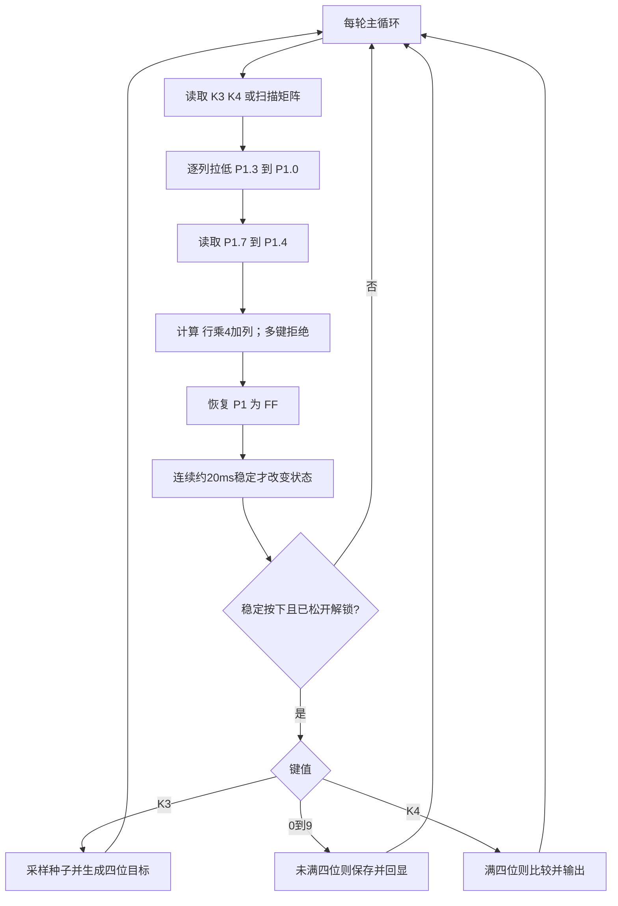
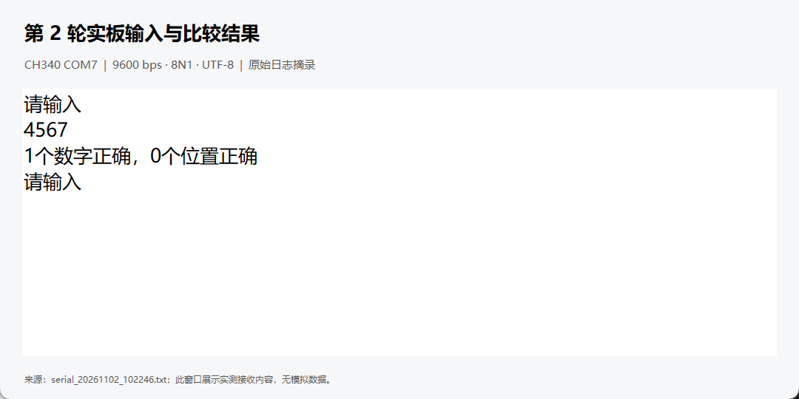

# 实验一：矩阵键盘与串口通信的猜数字游戏

## 文件与当前验证范围

- `experiment1.uvproj`：Keil C51 工程，可直接打开。
- `main.c`：普中板串口、键盘和游戏状态控制。
- `game.c`、`game.h`：四位数比较，重复数字按次数匹配。
- `experiment1.hex`：实际由本机 Keil C51 编译、链接生成。
- 实际编译结果：0 错误、0 警告，code=1837 字节，data=46 字节。
- 比较算法已用独立的数字频次算法验证 80000 组输入，覆盖全零、前导零、重复数字、位置交换和全部匹配。
- 上述软件验证不能替代开发板按键及串口实测。PZ-ISP 已实际完成程序区擦除及写入，日志显示“恭喜!文件下载完毕!”（4.958s），见 PZ下载记录.txt。随后 COM7 实际收到程序启动信息、“请输入”和不足四位确认提示。已采集三轮独立开始后的输入与比较记录，见文末。截图为原始串口日志摘录在本地日志查看器中的显示；尚未实板触发猜中分支，不能称为三轮从开始到猜中结束的完整游戏。

## 与指导书的差异

参考用户提供的开发攻略第 13、14、22 章，以及本地 `4--实验程序/1--基础实验` 下的 `8-独立按键实验.zip`、`9-矩阵按键实验.zip`、`18-串口通信实验.zip`。

指导书功能描述使用 K1/K2，但这两个键分别接 P3.1/TXD 和 P3.0/RXD，与串口冲突。程序改用 K3（P3.2）开始或重新开始，K4（P3.3）确认。使用串口时不要按 K1/K2。

普中参考程序按实际矩阵接线扫描：P1.3、P1.2、P1.1、P1.0 依次选列，P1.7、P1.6、P1.5、P1.4 依次读行。将原示例 1～16 键值减一，得到指导书要求的 0～15。S1～S10 输入 0～9，S11～S16 无效。不能直接照抄指导书中按位递增的行列映射。

## 操作

1. 下载工具已识别 STC89C52RC/LE52RC、12T 模式；开发板照片的晶振标注为 11.0592MHz。
2. CH340 旁 P5 跳线需将 UTX/UTXD 接 P3.0，URX/URXD 接 P3.1；不要短接 RX 与 TX。
3. 下载 `experiment1.hex`，串口助手选系统当前识别到的 CH340 端口（本次为 COM7）、9600、8 位数据、无校验、1 位停止位、无流控。
4. 接收显示选择 UTF-8 文本，关闭 HEX 显示；程序中的中文是明确的 UTF-8 字节，不依赖 Keil 编辑器编码。
5. 按 K3，串口出现“请输入”；按矩阵 S1～S10 输入四位数字，每位均有回显；按 K4 确认。
6. 不足四位确认时保留已输入数字并提示 `Need 4 digits.`；满四位后额外数字不计入。
7. 猜错后输出正确数字数和正确位置数，并自动等待下一组四位输入；猜对后输出“恭喜你，全对了”，再按 K3 开新局。
8. K3 在游戏中也可重新开始。按键需松开后再按，长按只记一次；同时多键不作为正常输入。

## 串口寄存器与计算

按普中串口示例采用 SMOD=1、重装值 FA，而非指导书的 SMOD=0、FD。两组配置在 11.0592MHz、12T 下都能得到 9600bps。

波特率 = 2^SMOD × Fosc / [32 × 12 × (256−TH1)]

= 2 × 11059200 / (32 × 12 × 6) = 9600。

|寄存器/位|设置|用途|
|---|---|---|
|TMOD|最终 0x21|T1 方式2自动重装，T0 方式1自由计数|
|SCON|初始化 0x50|串口方式1，允许接收|
|PCON.SMOD|1|波特率倍速，保留 PCON 其他位|
|TH1/TL1|0xFA/0xFA|9600 波特率重装值|
|TR1|1|启动波特率定时器|
|ES|0|本实验仅需发送，以轮询 TI 等待发送完成|
|TI/RI|初始化均为0|清串口标志|
|ET0|0|T0 不使用中断|
|TR0|1|持续计数，为开始时刻提供种子扰动|

不照搬示例的接收中断回发逻辑：本实验输入来自矩阵键盘，不需要 PC 回传；采用轮询发送避免 TI 与串口中断处理冲突。

## 随机数和结果含义

每次开始时采样 T0 的完整 16 位计数并混入种子，再使用指导书给出的线性同余参数：`seed=((seed^timer)*1103515245UL+12345UL)&0x7FFFUL`，`number=seed%10000UL`。使用 unsigned long 避免 16 位乘法截断；四位拆分保留前导零。它是教学用伪随机数，不能保证连续两局不同。

X 按“数字正确总数”解释，包含位置也正确的数字；Y 是其中位置正确的数量。若教师将 X 定义为仅数字对、位置错，报告应明确改成 X−Y。重复数字不得超出目标中的出现次数，例如目标 1122、猜测 1111，X=2、Y=2；目标 1234、猜测 4321，X=4、Y=0。

## 扫描流程图

## 思考题

1. 行列两步扫描分别识别交叉点的两个坐标，减少所需 I/O。一种替代是逐列拉低并读取行线，本程序采用此法；仅对静态端口读取一次，通常无法获得全部行列组合的位置。按键还需要消抖和松手检测。
2. P3.0/P3.1 与 K2/K1 复用。按键会把接收或发送线拉低，破坏通信波形；晶振与重装值不匹配、SMOD 设置错误、串口助手波特率或字符编码不匹配也会造成乱码。用 K3/K4 代替控制键，保留串口引脚，检查跳线并统一串口参数。

## 三轮实测记录

本次三轮均先按 K3 重新生成目标，再输入四位数字并按 K4。以下均为 COM7 实际接收内容，原始日志见 `serial_20261102_102246.txt`，下载过程见 `PZ下载记录.txt`。

|轮次|四位回显|实际比较输出|分析|
|---|---|---|---|
|1|0123|2个数字正确，1个位置正确|X=2、Y=1，满足0≤Y≤X≤4；继续提示输入|
|2|4567|1个数字正确，0个位置正确|X=1、Y=0，满足计数约束；继续提示输入|
|3|8901|2个数字正确，0个位置正确|X=2、Y=0，满足计数约束；继续提示输入|

截图来自本地日志查看器对实际串口日志的摘录展示，并非模拟串口输出，也不是 PZ-ISP 接收窗口截图。完整原始日志保留了调试时的重启、额外按键和偶发无效字符，未用整理后的摘录替代原始证据。

正式固件不输出隐藏目标，故这三轮能证明键盘回显、确认、反馈及继续输入流程正常，不能独立核验每轮X/Y与隐藏目标逐位相符。比较算法另有80000组软件测试通过；猜中结束和再开始分支已实现，但尚未获得实板猜中记录。本次记录是三轮开始后的单次猜测，非三轮完整猜中通关。

## 复现与后续操作

- 下载：PZ-ISP 选择 STC89C5xx-RC Series、COM7、9600、12T，打开本目录 HEX，点击程序下载，再给开发板断电重启；日志应显示文件下载完毕。
- 查看串口：在本目录运行 `python serial_monitor.py --port COM7`。如提示缺少 serial，安装 `pyserial`。按 Ctrl+C 停止并释放串口；不能同时用多个程序打开 COM7。
- 本次采集结束已停止监视并释放 COM7。正式固件保留在开发板中。
